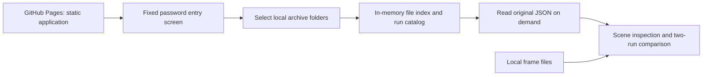

# OpenEnricher Experiment Explorer

Design proposal · 29 October 2026 · Revised after scope clarification

## Current UI revision

The workspace now starts empty: bundled sample runs and synthetic frame slots have been removed. Import one folder at a time; actual missing frames show an unavailable state. The UI uses self-hosted Manrope, slightly larger secondary text, subtle transitions with reduced-motion support, and syntax highlighting in JSON inspectors. Local-inspection status appears once in a compact note. Live evaluation is an architectural option documented in `docs/LIVE_EVALUATION.md`, not an enabled feature.

## Purpose and scope

A small, read-only Next.js application for inspecting metadata extraction experiments. The primary task is to select a configuration and a film/episode, inspect its time windows alongside visual and transcript evidence, and understand quality and processing cost.

The interface and documentation are in English. Original pipeline text is displayed verbatim, including mistakes: this is an inspection tool, so generated output must not be silently corrected or translated.

This document defines the agreed first-release scope. No application scaffolding, deployment or upstream pipeline changes have been made.

## Evidence inspected

Source: private repository `napolitanodario/open-enricher`, default branch `main`, commit [`dd8f821`](https://github.com/napolitanodario/open-enricher/commit/dd8f821f51d71647daefce4e2d39c1a18949b2f4), “added frames sampling divided by scene and uploaded results from latest experiments”.

The cloud checkout is older (`d53e000`). Git fetch could not reach the environment proxy, so the latest tree, output examples and frame-generation source were inspected through the GitHub connector. No checkout was reset.

The latest tree contains four archived configurations: `01-scene-context`, `02-memory-2`, `03-memory-4`, and `05-visual-only`. Each currently contains results for `Suits.S01E02.mkv`. A synopsis also exists for this episode and for `Stranger_Things.S01E03.mkv`; a synopsis alone does not imply an archived extraction exists.

| Source artifact | Observed content | Intended presentation |
| --- | --- | --- |
| `variant.json` | ID, title, interval, VLM memory window, visual-only flag | Configuration header and comparison differences |
| `<video>/result.json` | Overall/stage status, artifact list, some embedded timing data | Run status and stage availability |
| `<video>_audio.json` | Array of `start_timestamp`, `end_timestamp`, `speaker`, `text` | Timestamped transcript, speaker filtering |
| `<video>_dialogue.json` | `plot_summary`, sampling flags, `scenes[]` with numeric and formatted boundaries, descriptions | Generated plot and per-window dialogue summaries |
| `<video>_vlm.json` | `scene_timeline[]`, visual descriptions, subjects/objects, actions, camera, lighting, screen text, parsing counts and memory settings | Scene metadata and extraction warnings |
| `<video>_llm.json` | RecSys metadata, search/discovery, audience profile, narrative hook and visual style | Whole-video metadata |
| `timings.json`, `*_timings.json` | Stage wall duration; named spans with durations, model and optional window/attempt | Phase bars and per-window performance |
| `score.json` | Five weighted dimensions, notes, overall, thresholds, provider/method, optional error | Evaluation with rationale and provenance |
| `scores.json`, `video_results.json` | Experiment-level summaries | Catalog summaries, checked against per-video evidence |
| `worker.log`, `*_vlm_raw.txt`, sidecar JSON | Diagnostics and extraction context | Collapsed source/diagnostic viewer |
| `synopsis/<video>_summary.txt` | Optional reference text | Reference synopsis alongside generated plot |

No archived JPEGs or `*_vlm_frames.json` are present in this commit's tree. Their future structure is defined by the new writer, described below.

Important semantics:

- Current “scenes” are fixed 300-second analysis windows, not detected narrative scenes. The inspected episode has nine windows; the last ends at `00:42:55`. The UI should say “Scene windows” and explain this once.
- Speaker IDs are diarization labels. Generated prose mentions possible character identities, inconsistently across windows; there is no reliable structured speaker-to-character mapping.
- `01-scene-context` has an evaluator provider timeout. Its fallback `overall: 1.0` is not a valid quality measurement.
- Valid evaluator reports for other configurations use title/model knowledge (`uses_synopsis: false`), and some statements disagree with the available dialogue. Scores are model judgments, not ground truth.
- A stage may be `skipped_cache` while an archived timing file still describes the original computation. That duration is evidence about the artifact, not necessarily elapsed work in this execution.

## Product structure

Use one compact application shell: product name, experiment/video selectors, source revision, and four tabs: **Scenes**, **Overview**, **Performance**, **Pipeline**. Evaluation lives in Overview and can be opened from a score badge. A compact catalog is the entry point; selecting a row opens Scenes. URL query parameters retain selection, tab, window and comparison, allowing direct links on GitHub Pages without dynamic server routes.

### Experiment catalog

A sortable table with configuration, video, available stage status, valid evaluation score, and measured processing duration with a clear cache qualification. Search by title/configuration; filter by video and evaluation state. Avoid a dashboard of decorative KPI cards.

Keep configuration identity separate from execution identity. The catalog supports approximately 50–60 runs, including multiple executions of the same configuration. Display configuration, run label/ID and execution time separately. For legacy archives without a run ID, identify each imported archive by its import session and relative run-folder path, visibly marking its identity as local; do not invent an execution timestamp. Missing artifacts, failed stages and failed evaluation are separate states.

### Scenes: the main workspace

Desktop layout: a narrow vertical window index on the left, a frame/contact-sheet area in the middle, and extracted metadata on the right. The transcript sits directly below the frames. Keep navigation and the selected window boundary visible while scrolling; collapse the index into a selector on smaller screens.

```text
OpenEnricher       [Experiment v] [Video v]        [Compare]
Scenes | Overview | Performance | Pipeline
-----------------------------------------------------------
Window index   03 · 00:10:00–00:15:00
01 00:00       [ selected frame                ]  Description
02 05:00       [1] [2] [3] [4] ...                 Subjects / actions
03 10:00       Sample time / availability           Camera / lighting
...            --------------------------------    On-screen text
               Transcript · speaker · time         Dialogue summary
               [search] [speaker filter]           [View source]
```

Interaction:

1. Select a window using the index or previous/next controls.
2. Browse sampled frames; open a larger image with timestamp and source path.
3. Read the visual description and dialogue summary as separate, labelled outputs.
4. Inspect actions, subjects/objects, shot/camera, lighting/color and on-screen text. These are extracted fields, not confirmed facts.
5. Search/filter transcript lines. Clicking a line selects an inspection time and highlights the nearest available frame, explicitly identifying it as a nearby sample. Video playback is deferred beyond the first release.
6. Open the original JSON or diagnostics when an output looks suspicious.

Transcript lines intersect a window when `line.start < window.end && line.end > window.start`; boundary-spanning lines may appear in both windows. At a selected instant, overlay dialogue only when the transcript interval contains that instant. Sparse frames must not cause nearby dialogue to be presented as occurring at the exact frame time. A compact transcript below the frames is the default; subtitles are optional.

Use `SPEAKER_04`/`UNKNOWN` as provided. Display character names only when an explicit mapping is supplied, with provenance/confidence if available. Do not infer authoritative identities by parsing generated prose. Optional aliases can be a later browser-local feature, visibly marked as user annotations.

### Overview: whole-video output and quality

Show the narrative hook and visual style, then genre, subgenres, pacing, mood, tags, topics, target audience and viewer interests. Place **Generated plot** and **Reference synopsis** in adjacent panels on desktop, with expandable long text. Keep both distinct from the short narrative hook.

Evaluation: overall `/5`, usability decision using supplied thresholds, and five horizontal dimension bars with weights and full notes. Show provider/model and whether the synopsis was used. Preserve original scales; do not turn `3.05/5` into “61% accuracy”. If normalized values are shown, label the supplied 0–1 normalization explicitly.

An `error` produces **Evaluation failed**, retains the error and raw report for inspection, and excludes fallback scores from averages/rankings. Missing reports show **Not available**. Parsing problems remain visible. Conflicting evaluator statements remain attributed opinions; do not rewrite extraction output to agree with them.

### Performance: durations now, precise traces when available

Provide horizontal duration bars grouped by stage, expanding into recorded phases and window-level generation rows. Use a common seconds/minutes axis for comparable rows; tooltips and a companion table show exact durations, original phase names, model, attempt and window. Selecting a window row opens its scene.

Map known phase names to Load, Generation/transcription, Alignment, Diarization and Other while retaining their original labels. Unknown phases still render.

Current data supports stage totals and phase-duration breakdowns. It does not support a measured global waterfall: array order in merged `timings.json` is not execution order, and spans lack start offsets. Duration bars start at zero and are labelled accordingly. Do not cumulatively position them and imply exact timing.

Where spans are known to be disjoint, show an uninstrumented remainder between stage wall time and measured phases. If overlap/nesting is unknown or totals exceed wall time, show individual spans and a timing-coverage warning rather than a fabricated remainder. Stage totals and child spans must never be added together.

In the new frame writer, `vlm_generate` wraps clip creation, frame-cache generation, model extraction and temporary-file cleanup. Label it **Window processing (includes preparation)**, not pure model inference. Frame-cache time is a contained measurement, not extra cost to add to that span. Older runs predate frame capture; use source provenance to explain instrumentation differences.

Cached stages show **Reused artifact — original timing**. Exclude them from the sum of executed stage wall durations, with a separate reference if useful. A sum of executed stage walls is labelled as such, not “Total run elapsed”: orchestration and evaluation may be unmeasured. Do not synthesize evaluation timing from scores.

### Pipeline: explain the configuration

A small readable SVG diagram with selectable nodes; no graph editor is needed. Show the observed `audio → dialogue → vlm → llm` stage sequence and evaluation after profile creation. Show video input to audio/VLM, generated plot into the final profile, and the dialogue-description edge into VLM only when `visual_only` is false. Display the VLM's previous-window memory as a separate annotation (`all previous`, `2`, `4`), rather than a misleading cross-stage cycle. The visual-only variant still uses dialogue-derived output elsewhere; do not imply the whole pipeline is silent-video-only.

Use `result.json` for executed/reused/failed status. The current variant JSON is configuration, not a full DAG, so dependencies are a documented adapter for this pipeline version and must be labelled “Derived from pipeline configuration”. Do not claim a complete graph was exported. Unknown stages remain listed with unresolved dependencies. Color data is optional and appears only when present.

## Future frame contract and placeholders

Read `<video>_vlm_frames.json` without asking the pipeline to produce a frontend-specific replacement. The new writer emits:

```json
{
  "stage": "vlm_frames",
  "wall_seconds": 0.0,
  "experiment_id": "01-scene-context",
  "video": "Suits.S01E02.mkv",
  "sample_fps": 2,
  "min_frames": 2,
  "max_frames": 8,
  "frame_factor": 2,
  "spans": [
    {
      "name": "vlm_frames",
      "window": 1,
      "start": "00:00:00",
      "end": "00:05:00",
      "seconds": 0.0,
      "clip_frames": 7200,
      "clip_fps": 24.0,
      "sampled_frames": 8,
      "frames": [
        {
          "sample": 1,
          "index": 0,
          "clip_seconds": 0.0,
          "timestamp_seconds": 0.0,
          "file": "runs/local/_cache/Suits.S01E02.mkv/frames/01-scene-context/scene_01/frame_01.jpg"
        }
      ]
    }
  ]
}
```

This is an illustrative partial record, not a measured output. Each span can instead contain `error` and `frames: []`. Join its 1-based `window` to the ordered dialogue windows and validate `start`/`end`. Join dialogue and VLM metadata by normalized boundaries, with an index fallback only when boundaries/counts agree; report mismatches. Frame paths are repository-relative and resolve against the published dataset root, preserving `_cache` paths.

Use actual `timestamp_seconds` when present. Sampling currently requests 2 FPS but caps long windows at eight evenly spaced frames; never interpret this as 600 saved images per five minutes. These are explainability copies from a re-encoded clip, not pixel-identical tensors fed to the model; original-video alignment can differ slightly.

For today's archives, show neutral 16:9 placeholders labelled **Frame unavailable — demo placeholder**. An illustrative eight-slot contact sheet may demonstrate layout but must not invent actual sampled timestamps. If timestamps later exist but JPEGs are missing, retain those real timestamps with unavailable-image tiles. Missing index, empty/error index, and missing JPEG are distinct states. No fabricated movie imagery is needed.

## Data and static hosting architecture

Recommended: Next.js App Router, TypeScript, static export (`output: 'export'`) to GitHub Pages. Configure the repository base path and static asset URLs, disable server image optimization, and keep selection in URL query parameters. No API routes, database, runtime server, authentication service or model calls are needed for the proposed public/local workflow.

A small ingestion adapter reads the original artifacts, validates their minimum structure, and creates an in-memory view model. Preserve unknown keys in the source viewer. Missing optional files should degrade individual panels, not fail the whole application.

The deployed site contains the application shell and demonstration placeholders only. Do not publish pipeline outputs, transcripts, synopses, frames or diagnostic logs as site assets. There is no cross-repository checkout, hosted dataset snapshot or build-generated experiment catalog in this scope.

After entering the application, the user selects a local archive folder. Build the catalog in browser memory from the selected files. Accept multiple imports so independent run archives can coexist in the same session. Show the imported run count, source folder labels, missing artifacts and a clear “Remove import” / “Clear all” control. Use directory selection where supported and a multiple-file fallback with explicit guidance about maintaining relative paths. No backend upload is involved.

Index files first, parse configuration/status/score summaries for the table, and parse transcripts and scene artifacts when a run/video is opened. Load image files on demand through object URLs and revoke them when no longer needed. This is sufficient for 50–60 runs without a database. Do not base64-encode the entire dataset into React state. Folder selection reads a snapshot; it does not continuously watch local files. Reimport is required to see pipeline updates.

Imported data and unlock state are session-only. Reloading requires reimporting files; URL selections can be restored after matching archives have been selected again. Do not persist transcripts or frames in local storage. Parse errors identify the artifact and expected field, with a raw inspection fallback.



### Fixed password entry screen

Use the requested constant password `1234`, with a single password input, submit button and plain invalid-password message. Retain unlock only for the current tab session and provide “Lock”. This is a convenience gate implemented in client JavaScript, not authentication or encryption: the password can be discovered or bypassed. This matches the stated non-sensitive-data use case. Local imports are not uploaded regardless of whether the gate is present. No auth service is introduced.

## Repeated executions and archive identity

The frontend can distinguish separate archive folders today, but cannot recover a run that the pipeline has overwritten. To preserve repeated executions reliably, the pipeline should write each execution to an immutable run directory. Keep the current per-video JSON files unchanged and add a small run manifest, for example:

```text
export/
  synopsis/<video>_summary.txt
  runs/local/<run_id>/
    run.json
    variant.json
    <video>/
      result.json
      timings.json
      score.json
      <video>_audio.json
      <video>_dialogue.json
      <video>_vlm.json
      <video>_vlm_frames.json
      <video>_llm.json
```

```json
{
  "schema_version": 1,
  "run_id": "20261029T103000Z-01-scene-context-a7c2",
  "experiment_id": "01-scene-context",
  "started_at": "2026-10-29T10:30:00Z",
  "source_commit": "<full pipeline commit SHA>"
}
```

These are proposed additions, not existing fields. `run_id` identifies the execution; `experiment_id` identifies the configuration. Use an ID unique per invocation, not just the configuration or a timestamp rounded to a day. Preserve the actual variant snapshot in each run. If the run manifest is unavailable, legacy run folders remain supported with visibly local identity.

Frame immutability matters too: the current `_cache/<video>/frames/<experiment_id>/` location can be overwritten by rerunning that configuration. Future exports should keep frames under a run-specific directory and emit their actual repository-relative paths in the existing frame JSON. The frontend follows those paths rather than assuming the cache layout. This is an archive/provenance improvement, not a new extraction schema or a database requirement. The importer should warn when separate runs reference the same mutable frame path.

Importing the same `run_id` again should prompt replacement or skipping rather than silently merging different artifacts. Runs without stable IDs remain separate imports. In a comparison, always display both run identities, including when configuration names match.

## Media scope

The first release supports local frame files and clearly labelled placeholders only. No video picker, player, streaming integration or external media hosting is required. Include the common parent containing both run outputs and any referenced `_cache` frame folders when selecting an export. Missing cache files remain visible as unavailable frames.

Keep frame resolution behind a small media adapter so optional playback can be added later. If needed, local video selection is the simplest future option; shared video can use S3/R2 delivery URLs while the application remains on Pages. Browser-compatible MP4 proxies and accurate time origins would be needed. Video files do not belong in the Git repository. These are future considerations, not first-release work.

## Minimal optional pipeline improvements

Existing output is sufficient for the first explorer; no broad JSON rewrite is recommended.

| Addition | Benefit | Priority |
| --- | --- | --- |
| `schema_version`, immutable `run_id`, source commit and actual model/config snapshot | Interpret changing schemas and preserve repeated executions | Recommended now; legacy folder identities remain supported |
| Numeric window boundaries and stable window ID across dialogue/VLM/frame artifacts | Reliable joins as segmentation evolves | Helpful; formatted boundaries work now |
| Run-relative `start_offset_seconds`, duration, `span_id`, `parent_span_id`, explicit stage ordering | Accurate waterfalls and nested phases | Required for precise traces |
| Distinct clip creation, frame capture, input preparation, model generation and cleanup spans | Separate inference from surrounding processing | Required for pure inference analysis |
| Explicit cache provenance and evaluation `status` | Clean separation of reused work, failure and low quality | Helpful; current status/error can be adapted |
| Exported nodes/edges and dependencies in a pipeline snapshot | Render arbitrary future pipeline variants accurately | Required once topology varies beyond known flags |
| Optional structured speaker mappings with source, scope and confidence | Character names without guessing from prose | Optional |

Timing offsets should use one run clock across stages. For example, add `start_offset_seconds: 120.4`, `span_id: "vlm-window-3"` and a parent reference to a span while retaining its current `seconds` field. Attach video-clock window boundaries separately: video time and execution time are different axes. Record cache-origin timing separately from work executed in this run. Capture hardware and relevant load/cache conditions when performance comparisons need to be reproducible.

## Visual direction

Confirmed direction: light neutral background, white panels, charcoal text, one restrained blue accent, subtle borders, minimal shadows and 6–8 px corner radii. Use a clean system sans-serif and tabular/monospaced time values. Maintain consistent labels and compact spacing; reserve color for selection, stage categories and status. No gradients, marketing hero sections or unnecessary animation.

Desktop-first, with a usable stacked tablet/mobile layout. Keyboard-operable selectors, tabs and frame controls; visible focus; text status in addition to color; full labels for score bars; readable transcript contrast; no hover-only information. Large frame sets and long transcripts are rendered progressively, and heavy source files open only when requested.

## Two-run comparison — first release

Compare two runs for the same video, including repeated executions of the same configuration, with shared window navigation, side-by-side generated fields, score deltas and stage/phase timing deltas. Show missing values explicitly. Compare only equivalent timing semantics and flag cache/instrumentation differences. If window boundaries differ, align by overlapping video intervals and show the differing boundaries rather than pairing array indices. Do not assign a single “winner” from one evaluator score.

## Delivery and acceptance

Implement local folder ingestion and run identity first, then Scenes/Overview, Performance/Pipeline, two-run comparison and the password entry screen, and finally static deployment packaging. Keep the first implementation focused on the supplied archives.

The result is ready when all four observed configurations can be selected; their nine windows and actual transcript fields render correctly; placeholders are visibly illustrative; future frame-index fixtures replace placeholders without UI changes; failed evaluation is not counted as low quality; cached timing is not added as newly executed work; repeated executions remain distinct; two runs of the same video can be compared; a representative 60-run local catalog remains responsive; the deployed app contains no real imported data; the fixed-password screen works; and the exported site works beneath the GitHub Pages repository path. After reload, selection links resolve once the matching local data has been imported again.

Verification should include adapter fixtures for missing/malformed files, cross-window transcript lines, inconsistent boundaries, valid/failed scores and cached stages; static-export/base-path checks; and a browser review of scene navigation, source inspection, responsive layout and media-unavailable states.

## Confirmed first-release decisions

| Decision | Agreed scope |
| --- | --- |
| Entry screen | Fixed client-side password `1234`; convenience gate |
| Hosting | GitHub Pages, static Next.js export |
| Input | Local folder imports only; no published experiment data |
| Comparison | Two runs of the same video, including the same configuration |
| Scale | Approximately 50–60 runs, no database |
| Identity | Preserve repeated executions; support legacy archives and recommend immutable upstream run IDs |
| Appearance | Light, clean, professional, utilitarian; desktop-first |
| Media | Frames only in the first release; placeholders when unavailable |
| Persistence | In-memory session; reimport after reload |

No further product clarification is required for this scope. The upstream run manifest and run-specific frame storage are recommendations for preserving history; they have not been implemented in the pipeline. The frontend can start with separate legacy archive folders.
